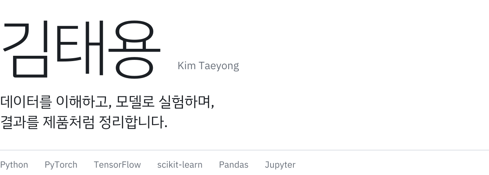
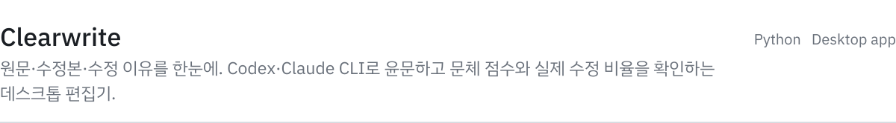
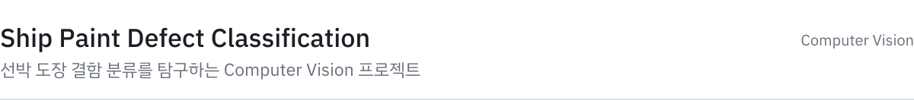
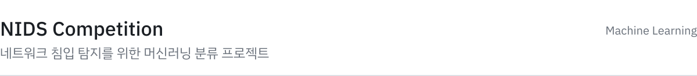
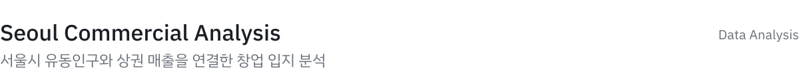
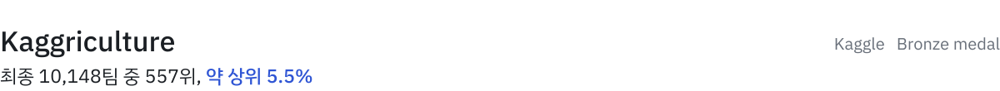
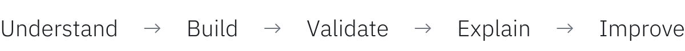

<picture>
  <source media="(prefers-color-scheme: dark)" srcset="./assets/hero-dark.svg" />
  
</picture>

## About me

- AI/ML 모델을 직접 만들고, 실험 결과를 해석하는 과정을 좋아합니다.
- 데이터 전처리부터 검증과 재현 가능한 결과물까지 꼼꼼하게 다룹니다.
- Computer Vision, 네트워크 침입 탐지, 데이터 스토리텔링을 탐구하고 있습니다.
- 작은 실험을 꾸준히 쌓아 실제 문제를 해결하는 개발자로 성장 중입니다.

## Featured projects

<a href="https://github.com/xoxo787/clearwrite"><picture>
  <source media="(prefers-color-scheme: dark)" srcset="./assets/project-clearwrite-dark.svg" />
  
</picture></a>
<a href="https://github.com/xoxo787/ship-paint-defect-classification"><picture>
  <source media="(prefers-color-scheme: dark)" srcset="./assets/project-ship-paint-dark.svg" />
  
</picture></a>
<a href="https://github.com/xoxo787/nids-competition"><picture>
  <source media="(prefers-color-scheme: dark)" srcset="./assets/project-nids-dark.svg" />
  
</picture></a>
<a href="https://github.com/xoxo787/seoul-commercial-analysis"><picture>
  <source media="(prefers-color-scheme: dark)" srcset="./assets/project-seoul-dark.svg" />
  
</picture></a>

## Kaggle achievement

<a href="https://www.kaggle.com/certification/competitions/xox787/kaggriculture"><picture>
  <source media="(prefers-color-scheme: dark)" srcset="./assets/kaggle-dark.svg" />
  
</picture></a>

[공식 인증서](https://www.kaggle.com/certification/competitions/xox787/kaggriculture) · [대회 기록과 출처](./achievements/kaggriculture.md)

## How I work

<picture>
  <source media="(prefers-color-scheme: dark)" srcset="./assets/workflow-dark.svg" />
  
</picture>

- 문제와 평가 기준을 먼저 이해합니다.
- 작은 베이스라인부터 만들고 실험을 기록합니다.
- 수치뿐 아니라 데이터 누수와 재현 가능성도 확인합니다.
- 결과를 다른 사람이 이해하고 다시 실행할 수 있게 정리합니다.

 

꾸준한 실험이 좋은 모델을 만든다고 믿습니다. · [Repositories](https://github.com/xoxo787?tab=repositories)
