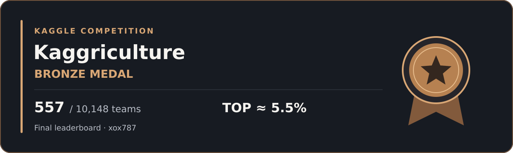

# Kaggriculture · Bronze Medal

Kaggle Kaggriculture 대회에서 동메달을 받았습니다.

[공식 수상 인증서](https://www.kaggle.com/certification/competitions/xox787/kaggriculture) · [최종 리더보드](https://www.kaggle.com/competitions/kaggriculture/leaderboard?search=xox787)

## 결과

| 항목 | 기록 |
| --- | --- |
| 대회 | Kaggriculture |
| Kaggle 계정 | xox787 |
| 수상 | Bronze Medal |
| 최종 순위 | 557 / 10,148 teams |
| 순위 비율 | 약 상위 5.5% |

상위 비율은 557 ÷ 10,148 × 100을 반올림한 값입니다. Kaggle의 별도 공식 등급을 뜻하지 않습니다.

## 이 기록에서 확인할 수 있는 것

수상 여부는 공식 인증서에서, 순위와 참가 팀 수는 대회 리더보드에서 확인할 수 있습니다. GitHub 계정명은 xoxo787, Kaggle 계정명은 xox787입니다.

이 문서는 확인 가능한 결과를 먼저 정리한 대회 기록입니다. 제출 코드와 실험 로그는 포함하지 않았으며, 구체적인 전략이나 성능 개선 원인은 공개 근거 없이 적지 않았습니다.

## 출처

- [Kaggle 공식 수상 인증서](https://www.kaggle.com/certification/competitions/xox787/kaggriculture)
- [Kaggriculture 대회](https://www.kaggle.com/competitions/kaggriculture)
- [Kaggriculture 리더보드](https://www.kaggle.com/competitions/kaggriculture/leaderboard?search=xox787)

기록일: 2026-10-20. 수상 카드는 결과를 정리한 자체 제작 이미지이며 Kaggle에서 발급한 인증서 이미지는 아닙니다.
